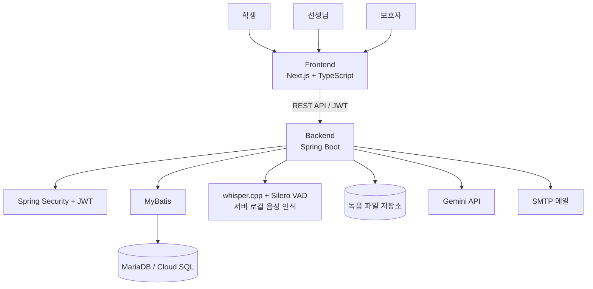
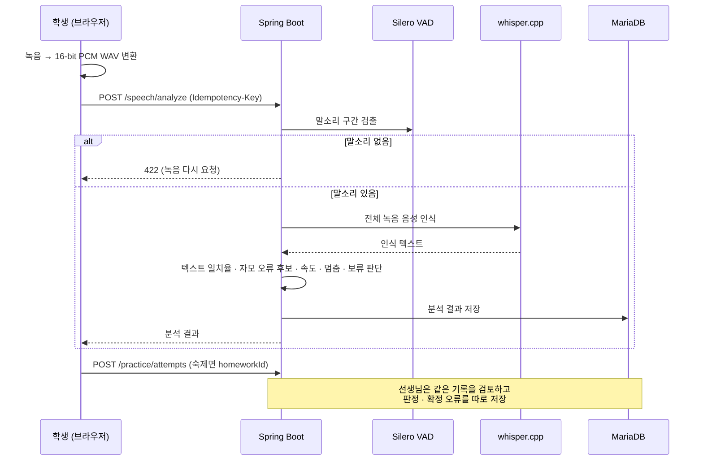
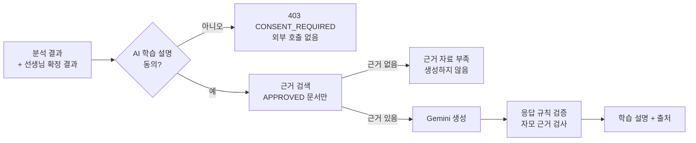

# 🗣️ ChatterLand (채터랜드)

> 아이의 말하기 연습을 돕는 언어 재활 학습 서비스 — 선생님이 숙제를 내고, 아이가 녹음하고, 서버가 음성을 인식·측정해 선생님과 보호자에게 같은 기록을 보여 줍니다.

ChatterLand는 언어치료·말하기 학습이 필요한 아동(학생), 담당 선생님, 보호자를 연결하는 웹 서비스입니다.

선생님은 담당 학생에게 연습 콘텐츠를 숙제로 배정하고, 학생은 낱말·문장을 읽고 녹음합니다. 녹음은 **서버 안에서 whisper.cpp로 음성 인식**되며(외부 전송 없음), 목표 문장과의 텍스트 일치율, 말하기 속도, 멈춤, 자모 단위 오류 후보가 기록됩니다. 선생님은 같은 기록을 보고 직접 판정·확정하고, 보호자는 연결된 자녀의 학습 리포트를 확인합니다.

AI는 **승인된 근거 자료만 사용하는 RAG 기반 학습 설명**과 주제별 AI 대화에 사용하며, 측정값이 아닌 것을 점수처럼 보이지 않도록 설계했습니다.

frontend: 한이슬 / backend: 연찬민

---

## 🌐 배포 서비스

**ChatterLand 바로가기**

https://chatter-land.vercel.app

### 배포 환경

| 구분 | 환경 |
|---|---|
| Frontend | Vercel |
| Backend | Google Cloud Run (Docker 이미지, Artifact Registry) |
| Database | Google Cloud SQL |
| 음성 파일 | Cloud Storage 버킷을 Cloud Run 볼륨으로 마운트 |
| CI/CD | GitHub Actions (CI 통과 후 main 브랜치 백엔드 자동 배포) |

### 배포 구성

```text
사용자 (브라우저 마이크 녹음 → WAV 변환)
  │
  ▼
Vercel (Next.js)
  │
  │ REST API (JWT)
  ▼
Cloud Run (Spring Boot + whisper.cpp)
  │            │              │
  ▼            ▼              ▼
Cloud SQL   Cloud Storage   Gemini API
            (녹음 파일)     (AI 대화 · 학습 설명)
```

> 배포 절차와 음성 인식 인프라 선택지(GPU / 작은 모델 / 외부 API)의 비교는 [docs/deploy/gcp-cloud-run.md](docs/deploy/gcp-cloud-run.md)에 정리했습니다.

---

## 🎬 시연 영상

| 영상 | 내용 |
|---|---|
| [chatterland-demo-2026-10-14.mp4](docs/demo/chatterland-demo-2026-10-14.mp4) | 선생님 숙제 배정 → 학생 녹음·분석 → 선생님 학습 기록 확인 (43초) |
| [chatterland-contest-60s.webm](docs/demo/chatterland-contest-60s.webm) | 공모전 발표용 60초 시연 |
| [chatterland-contest-ai-chat-clip.webm](docs/demo/chatterland-contest-ai-chat-clip.webm) | AI 대화 (실제 Gemini 응답) |

모든 시연은 Playwright로 **실제 서버를 한 번 실행한 과정을 자르지 않고 녹화**했습니다. 마이크 입력은 합성음이며 실제 아동 음성이 아닙니다. 촬영 조건은 [docs/demo/README.md](docs/demo/README.md)에 있습니다.

---

## ✨ 주요 기능

### 👦 학생

- 오늘의 숙제 확인 및 숙제 연습 바로 시작
- 카테고리별 자율 연습 (발음 · 어휘 · 유창성 · 표현력 · 이해력)
- 연습 콘텐츠 검색 및 필터 (카테고리 · 난이도 · 발음 유형 · 콘텐츠 유형)
- 낱말 / 문장 읽기 녹음 및 내 녹음 다시 듣기
- 음성 인식 결과, 텍스트 일치율, 말하기 속도, 멈춤 확인
- 분석 결과에 대한 AI 학습 설명 (근거 자료 출처 표시)
- 주제별 AI 대화 (텍스트 / 음성 메시지)
- 맞춤 연습 추천
- 학습 히스토리 (자율 연습 / 숙제 연습 구분)
- 마이페이지: 프로필 수정, 동의 관리, 보호자 연결 관리

### 🧑‍🏫 선생님

- 담당 학생 등록 · 수정 · 해제
- 숙제 등록 / 수정 / 삭제 및 연습 콘텐츠 지정
- 학생별 학습 현황과 연습 기록 (자율 / 숙제 필터)
- 녹음 재생 및 자동 분석 결과 검토
- 선생님 판정과 확정 오류(대치 · 생략 · 왜곡 · 첨가) 기록
- 학생이 본 AI 설명 함께 보기
- 학생별 분석 대시보드 (영역별 레이더 차트)
- 학습 리포트 조회 및 한글 PDF 다운로드

### 👪 보호자

- 학생이 발급한 연결 코드로 자녀 연결
- 자녀 학습 리포트 및 학습 기록 조회
- 연결 해제

### 👤 계정 · 동의

- 회원가입 (학생 / 선생님 / 보호자 역할)
- 로그인 / 로그아웃, Access · Refresh Token 재발급
- 아이디 찾기
- 이메일 인증 코드 기반 비밀번호 재설정
- 비밀번호 변경
- 알림 설정
- 항목별 동의 관리 (음성 녹음, AI 대화, AI 학습 설명 등) — 동의가 없으면 외부 AI를 호출하지 않음

### 🎙️ 음성 분석

- 서버 로컬 음성 인식 (whisper.cpp + Whisper large-v3-turbo)
- Silero VAD로 말소리 없는 녹음 거부 (배경 소음이 문장으로 바뀌는 문제 방지)
- 음절 기반 텍스트 일치율
- 자모 정렬 기반 대치 · 생략 · 첨가 **후보** 추출 (확정 아님)
- 목표 음소와 위치(초성 / 종성, 어두 / 어중 / 어말) 표시
- 말하기 속도, 앞뒤 무음, 멈춤 구간 측정
- 잘림 · 너무 짧음 · 클리핑 · 작은 소리 · 길이 불일치 시 **판정 보류(HOLD)** 와 사유 기록
- 같은 문항 최근 5회 결과와 반복 비교
- 분석 버전 · 엔진 · 모델 이름 기록

### 🤖 AI 활용

- Gemini 기반 학습 설명 생성 (RAG)
- 승인된 근거 자료만 검색 대상으로 사용 — 근거가 없으면 지어내지 않고 "근거 자료 부족"으로 응답
- 응답에 근거 자료 출처 연결
- 주제별 AI 대화 (음성 메시지는 로컬 인식 후 텍스트만 전송, 원본 삭제)
- OpenAI 호환 / Gemini 네이티브 엔드포인트 모두 지원

### 🛡️ 개인정보 · 안전

- 녹음 파일 보관 기간 만료 시 스케줄러로 자동 삭제
- 음성 녹음 동의 철회 시 해당 학생 녹음 즉시 삭제
- 로그 마스킹 (이메일 · 토큰 등)
- 선생님–학생, 보호자–자녀 관계를 서버에서 확인하는 권한 검사

---

## 🛠️ 기술 스택

### Frontend

| 기술 | 사용 목적 |
|---|---|
| Next.js 16 (App Router) | 라우팅 및 페이지 구성 |
| React 19 | UI 개발 |
| TypeScript 6 | 정적 타입 관리 |
| TanStack Query 5 | 서버 상태 및 비동기 데이터 관리 |
| Tailwind CSS 4 | UI 스타일링 |
| Recharts | 학습 분석 차트 |
| lucide-react | 아이콘 |
| Web Audio API | 브라우저 녹음 및 16-bit PCM WAV 변환 |
| Vitest / Testing Library | 컴포넌트 · 단위 테스트 |
| Playwright | E2E 테스트 및 시연 영상 녹화 |

### Backend

| 기술 | 사용 목적 |
|---|---|
| Java 17 | 백엔드 개발 |
| Spring Boot 4.0.6 | REST API 서버 |
| Spring Security | 인증 및 역할 기반 인가 |
| JJWT 0.12.7 | JWT 생성 및 검증 |
| MyBatis 3.0.4 | 데이터베이스 접근 (XML Mapper) |
| MariaDB / MySQL | 데이터베이스 |
| Spring Validation | 요청 데이터 검증 |
| Spring Mail | 비밀번호 재설정 인증 메일 |
| Apache PDFBox | 한글 글꼴(나눔고딕) 임베딩 PDF 리포트 |
| Swagger / OpenAPI (springdoc) | API 문서화 |
| whisper.cpp + Silero VAD | 서버 로컬 음성 인식 및 말소리 구간 검출 |
| Gemini API | AI 대화 · RAG 학습 설명 |
| GreenMail / Mailpit | 메일 테스트 |

### Infra / DevOps

| 기술 | 사용 목적 |
|---|---|
| Docker / Docker Compose | 백엔드 이미지 및 로컬 DB |
| GitHub Actions | CI (단위 · 통합 · 프런트 · E2E) 및 백엔드 자동 배포 |
| Google Cloud Run · Cloud SQL · Cloud Storage | 백엔드 · DB · 녹음 파일 운영 |
| Vercel | 프런트엔드 배포 |

---

## 🏗️ 시스템 구조



### 음성 분석 흐름



### AI 학습 설명 (RAG) 흐름



---

## 📁 프로젝트 구조

```text
ChatterLand/
│
├── frontend/
│   ├── src/
│   │   ├── app/                    # Next.js URL 진입점 (얇은 page.tsx)
│   │   │   ├── login/ signup/ find-id/ reset-password/
│   │   │   ├── student/            # 연습 · AI 대화 · 세션 · 히스토리 · 마이페이지
│   │   │   ├── teacher/            # 학생 · 숙제 · 분석 · 리포트
│   │   │   └── guardian/           # 자녀 목록 · 자녀 상세
│   │   │
│   │   ├── features/               # 도메인별 페이지 · 컴포넌트 · API · 훅
│   │   │   ├── auth/
│   │   │   ├── account/
│   │   │   ├── consent/
│   │   │   ├── student/
│   │   │   ├── teacher/
│   │   │   ├── guardian/
│   │   │   ├── center/
│   │   │   ├── practiceContent/
│   │   │   ├── speechMetrics/
│   │   │   ├── aiFeedback/
│   │   │   └── learningReport/
│   │   │
│   │   ├── layouts/                # RoleLayout · PageLayout · AppTopBar
│   │   ├── routes/path/paths.ts    # 경로 상수
│   │   └── shared/
│   │       ├── api/                # 공통 API Client · Idempotency-Key
│   │       ├── components/         # 공통 UI
│   │       ├── assets/
│   │       └── styles/variables.css
│   │
│   ├── e2e/                        # Playwright E2E
│   ├── e2e-demo/                   # 시연 영상 녹화 스크립트
│   └── package.json
│
├── backend/
│   ├── src/main/java/com/example/backend/
│   │   ├── config/                 # MyBatis · RestClient · Scheduling
│   │   ├── chld/
│   │   │   ├── controller/
│   │   │   ├── service/
│   │   │   ├── service/impl/
│   │   │   ├── mapper/
│   │   │   ├── dto/request/
│   │   │   ├── dto/response/
│   │   │   └── exception/
│   │   └── global/
│   │       ├── exception/          # GlobalExceptionHandler · ErrorResponse · LogMasking
│   │       ├── jwt/
│   │       └── security/
│   ├── src/main/resources/
│   │   ├── mapper/                 # MyBatis XML
│   │   ├── schema.sql              # 테이블 · 기본 콘텐츠 · RAG 자료
│   │   ├── data.sql                # 연습 콘텐츠 seed
│   │   └── fonts/                  # 나눔고딕 (OFL)
│   ├── scripts/test-db.sh          # 격리된 테스트 DB
│   ├── Dockerfile
│   └── compose.yaml
│
├── docs/
│   ├── design/                     # 기능별 설계 문서
│   ├── speech/                     # 음성 분석 · 보류 기준
│   ├── testing/                    # 테스트 계획 · 케이스 · 결과
│   ├── deploy/                     # GCP 배포 절차
│   └── demo/                       # 시연 영상
│
├── scripts/                        # 전체 테스트 실행 · CI 보조 스크립트
└── .github/workflows/              # ci.yml · deploy-backend.yml
```

---

## 🧩 Backend API 구성

모든 API는 `/api/v1` 아래에 있으며, 보호된 API는 JWT 역할과 담당 관계를 서버에서 확인합니다.

### 인증 / 계정

| Method | Endpoint | 설명 |
|---|---|---|
| POST | `/auth/signup` | 회원가입 |
| POST | `/auth/login` | 로그인 |
| POST | `/auth/refresh` | 토큰 재발급 (Refresh Token 회전) |
| POST | `/auth/logout` | 로그아웃 |
| GET | `/auth/me` | 현재 사용자 |
| POST | `/auth/find-id` | 아이디 찾기 |
| POST | `/auth/password-reset/request` | 재설정 인증 코드 메일 발송 |
| POST | `/auth/password-reset/verify` | 인증 코드 확인 |
| POST | `/auth/password-reset/confirm` | 비밀번호 재설정 |
| PATCH | `/auth/me/password` | 비밀번호 변경 |
| PATCH | `/account/profile` | 프로필 수정 |
| GET / PUT | `/account/notification-settings` | 알림 설정 |
| GET | `/consents/me` | 내 동의 목록 |
| PUT | `/consents/me/{type}` | 동의 / 철회 |
| GET | `/centers` | 센터 목록 |

### 학생

| Method | Endpoint | 설명 |
|---|---|---|
| GET | `/students/me` | 학생 프로필 |
| GET | `/students/me/homeworks` | 내 숙제 |
| PATCH | `/students/me/homeworks/{homeworkId}/complete` | 숙제 완료 |
| GET | `/students/me/sessions` | 수업 세션 목록 |
| GET | `/sessions/{sessionId}` | 세션 상세 |
| GET | `/students/me/recommendations` | 연습 추천 |
| GET | `/students/me/learning-status` | 학습 현황 |
| GET | `/students/me/history` | 학습 히스토리 |

### 연습 / 음성 분석

| Method | Endpoint | 설명 |
|---|---|---|
| GET | `/practice/categories` | 연습 카테고리 |
| GET | `/practice/{categoryId}/exercises` | 카테고리별 연습 |
| GET | `/practice/{categoryId}/practiced` | 연습한 항목 |
| GET | `/practice-contents` | 연습 콘텐츠 검색 · 필터 |
| GET | `/practice-contents/{exerciseId}` | 연습 콘텐츠 상세 |
| POST | `/practice/attempts` | 연습 결과 저장 |
| POST | `/speech/analyze` | 녹음 업로드 및 분석 (multipart) |
| GET | `/speech/analyses/{analysisId}` | 분석 결과 조회 |
| GET | `/speech/analyses/{analysisId}/feedback` | AI 학습 설명 조회 |
| POST | `/speech/analyses/{analysisId}/feedback` | AI 학습 설명 생성 |

### AI 대화

| Method | Endpoint | 설명 |
|---|---|---|
| GET | `/ai/conversations` | 대화 목록 |
| POST | `/ai/conversations` | 대화 시작 |
| POST | `/ai/conversations/{conversationId}/messages` | 메시지 전송 (텍스트 / 음성) |
| GET | `/ai/conversations/{conversationId}/contents` | 대화 내용 |
| POST | `/ai/conversations/{conversationId}/end` | 대화 종료 |

### 선생님 (`/teachers/me`)

| Method | Endpoint | 설명 |
|---|---|---|
| GET | `/students` | 담당 학생 목록 |
| GET | `/students/available` | 등록 가능한 학생 |
| POST / PUT / DELETE | `/students/{studentId}` | 담당 학생 등록 · 수정 · 해제 |
| GET | `/students/{studentId}` | 학생 상세 |
| GET | `/students/{studentId}/sessions` | 학생 세션 |
| GET | `/students/{studentId}/practice-attempts` | 연습 기록 (자율 / 숙제) |
| GET | `/students/{studentId}/practice-summary` | 연습 요약 |
| GET | `/students/{studentId}/analytics` | 학습 분석 |
| GET | `/students/{studentId}/learning-report` | 학습 리포트 |
| GET | `/students/{studentId}/report` | 리포트 데이터 |
| GET | `/students/{studentId}/report/download` | 리포트 PDF 다운로드 |
| GET | `/students/{studentId}/speech-analyses` | 학생 음성 분석 목록 |
| GET | `/speech-analyses/{analysisId}/audio` | 녹음 재생 |
| GET | `/speech-analyses/{analysisId}/feedback` | 학생이 본 AI 설명 |
| PATCH | `/speech-analyses/{analysisId}/review` | 선생님 판정 · 확정 오류 저장 |
| GET / POST | `/homeworks` | 숙제 목록 · 등록 (Idempotency-Key) |
| PATCH / DELETE | `/homeworks/{homeworkId}` | 숙제 수정 (낙관적 잠금) · 삭제 |

### 보호자

| Method | Endpoint | 설명 |
|---|---|---|
| POST | `/students/me/guardian-link-codes` | (학생) 보호자 연결 코드 발급 |
| GET | `/students/me/guardians` | (학생) 연결된 보호자 |
| GET | `/students/me/guardian-events` | (학생) 보호자 연결 이력 |
| DELETE | `/students/me/guardians/{guardianId}` | (학생) 보호자 연결 해제 |
| GET / POST | `/guardians/me/children` | 자녀 목록 · 연결 |
| GET / DELETE | `/guardians/me/children/{studentId}` | 자녀 상세 · 연결 해제 |
| GET | `/guardians/me/children/{studentId}/learning-report` | 자녀 학습 리포트 |
| GET | `/guardians/me/children/{studentId}/history` | 자녀 학습 기록 |

> 상세 요청 파라미터와 응답 스키마는 Swagger UI(`/swagger-ui/index.html`)를 참고하세요.

---

## 🎨 Frontend 주요 페이지

| 페이지 | 경로 | 설명 |
|---|---|---|
| 시작 | `/` | 스플래시 · 로그인 / 회원가입 |
| 로그인 | `/login` | 학생 / 선생님 / 보호자 로그인 |
| 회원가입 | `/signup` | 역할 선택 · 동의 |
| 아이디 찾기 | `/find-id` | 아이디 찾기 |
| 비밀번호 재설정 | `/reset-password` | 메일 인증 코드로 재설정 |
| 학생 홈 | `/student` | 오늘의 숙제 · 추천 · 학습 현황 |
| 연습하기 | `/student/practice` | 카테고리 · 콘텐츠 찾기 · 녹음 · 결과 |
| AI 대화 | `/student/ai-chat` | 주제 선택 · AI 대화 |
| 수업 | `/student/sessions` | 세션 목록 · 세션 연습 |
| 히스토리 | `/student/history` | 학습 기록 |
| 마이페이지 | `/student/mypage` | 프로필 · 동의 · 보호자 연결 |
| 선생님 홈 | `/teacher` | 대시보드 |
| 제자 관리 | `/teacher/students` | 담당 학생 · 학습 현황 · 녹음 검토 |
| 숙제 관리 | `/teacher/homeworks` | 숙제 등록 · 수정 · 삭제 |
| 분석 | `/teacher/analytics` | 학생별 분석 차트 |
| 리포트 | `/teacher/reports/:studentId` | 학습 리포트 · PDF 다운로드 |
| 보호자 홈 | `/guardian` | 연결된 자녀 |
| 자녀 상세 | `/guardian/children/:studentId` | 자녀 학습 리포트 · 기록 |

---

## 🧱 Frontend 구조 설계

### Feature 기반 구조

`app/**/page.tsx`는 URL과 기능 페이지를 연결하는 얇은 진입점으로 두고, 화면 UI와 동작은 `features/<domain>`에 둡니다.

```text
app/teacher/students/page.tsx
        ↓
features/teacher/pages/TeacherPage.tsx
        ↓
features/teacher/components/*   +   features/teacher/hooks/*
        ↓
features/teacher/api/*
        ↓
shared/api/client.ts
```

### 공통 컴포넌트

여러 역할 화면에서 반복되는 UI는 `shared/components`로 올려 같은 디자인 토큰을 공유합니다.

```text
shared/components/
├── button/        Button
├── input/         Input
├── textarea/      Textarea
├── select/        Select
├── formField/     FormField
├── card/          Card
├── cardGrid/      CardGrid
├── menuCard/      MenuCard
├── badge/         Badge
├── stat/          Stat
├── progressBar/   ProgressBar
├── tabs/          Tabs
├── pagination/    Pagination
├── pageHeader/    PageHeader
├── backButton/    BackButton
├── modal/         Modal
├── spinner/       Spinner
├── mascot/        Mascot
└── feedback/      LoadingState · EmptyState · ErrorState · ConfirmDialog · Notice
```

### Layout

역할별 화면은 공통 레이아웃을 공유합니다.

```text
RoleLayout
├── Student
├── Teacher
└── Guardian

PageLayout + AppTopBar
└── 각 화면의 제목 · 뒤로가기 · 액션 영역
```

### 서버 상태 관리

```text
Server State      → TanStack Query (기능별 훅)
Client / UI State → useState / useReducer
```

### 녹음 처리

```text
MediaRecorder / Web Audio API
        ↓
브라우저에서 16-bit PCM WAV 변환
        ↓
Idempotency-Key와 함께 multipart 업로드
        ↓
분석 결과 화면 (측정값 · 보류 사유 · AI 설명)
```

---

## 🗄️ Database

MyBatis XML Mapper와 MariaDB(운영은 Cloud SQL for MySQL)를 사용합니다. `schema.sql`은 조건부 `CREATE` / `ALTER`로 작성해 기존 데이터를 지우지 않고 반복 실행할 수 있습니다.

| 영역 | 테이블 |
|---|---|
| 사용자 · 인증 | `users`, `student_profiles`, `centers`, `refresh_tokens`, `password_reset_requests`, `password_change_failures`, `notification_settings` |
| 관계 | `teacher_students`, `guardian_students`, `guardian_link_codes`, `guardian_link_failures` |
| 동의 | `user_consents` |
| 연습 콘텐츠 | `practice_categories`, `exercises`, `exercise_items` |
| 수업 · 숙제 | `therapy_sessions`, `session_exercises`, `homeworks`, `homework_exercises` |
| 음성 분석 · 연습 기록 | `speech_analyses`, `practice_attempts` |
| AI | `conversations`, `conversation_messages`, `speech_ai_feedback` |
| RAG 지식베이스 | `knowledge_documents`, `knowledge_chunks` |

---

## 📌 개발 포인트

### 1. 서버 로컬 음성 인식

아동 음성을 외부로 보내지 않기 위해 whisper.cpp를 서버에서 직접 실행합니다. Apple Silicon 기준 요청당 약 2.6–3.3초가 걸리며, `WHISPER_MAX_CONCURRENCY`로 동시 추론 수를 제한합니다.

- 성인 낭독 40문장(Zeroth-Korean) 음절 오류율 **9.5%**
- 소음만 있는 녹음 20개 중 19개가 "감사합니다." 같은 문장으로 인식되는 문제를 확인 → **Silero VAD로 말소리 없는 녹음을 422로 거부**
- VAD로 녹음을 잘라 인식하면 짧은 낱말 첫소리가 잘려(풀 → 툴) VAD는 "말소리 유무 판단"에만 사용

### 2. 측정값과 점수를 구분하는 설계

Whisper는 잘못 발음한 말을 올바른 낱말로 "고쳐서" 인식합니다(숩속 → 숲속). 그래서 텍스트 일치율을 **발음 점수로 쓰지 않고**, 화면에 "발음 점수 아님"을 명시했습니다.

- 발음 정확도는 검증된 아동 음소 모델이 없어 "준비 중"으로 표시
- 자모 정렬 오류는 **후보**로만 저장하고, 선생님 확정 결과는 별도 컬럼에 저장 (자동 결과를 덮어쓰지 않음)
- 녹음이 잘리거나 너무 작거나 짧으면 결과를 내지 않고 **판정 보류(HOLD)** 와 사유를 기록

### 3. 근거 기반 AI 학습 설명 (RAG)

- 근거 문서는 출처 · 사용 권한 확인(`VERIFIED`)과 내용 승인(`APPROVED` + 승인자 기록)을 별도 단계로 관리
- 승인 조건을 **SQL과 Java 양쪽에서 강제**하고, 설정값으로는 대상을 좁히기만 가능
- 근거가 없으면 생성하지 않고 "근거 자료 부족"으로 응답
- AI 오류를 `AI_NOT_CONFIGURED`, `AI_RATE_LIMITED`, `AI_TIMEOUT` 등으로 구분하고, 키와 제공자 응답 본문은 응답 · 로그에 남기지 않음

### 4. 중복 요청 · 동시 수정 방지

- 음성 분석과 숙제 등록에 `Idempotency-Key` 적용 — 응답 유실 후 재전송해도 같은 숙제가 두 번 생기지 않음 (DB 유니크 제약 기반)
- 같은 키 · 다른 내용은 409 `IDEMPOTENCY_KEY_REUSED`
- 숙제 수정에 낙관적 잠금(version) 적용
- 비밀번호 재설정 후 기존 토큰 무효화

### 5. 역할 · 관계 기반 권한

학생 / 선생님 / 보호자 역할을 JWT로 구분하고, "이 선생님의 담당 학생인지", "이 보호자에게 연결된 자녀인지"를 서버에서 확인합니다. 요청 본문의 사용자 ID를 믿지 않고 인증 principal을 기준으로 처리합니다. Refresh Token은 해시로 저장하고 재발급 시 회전합니다.

### 6. 개인정보 보호

- 항목별 동의 (음성 녹음 · AI 대화 · AI 학습 설명) — 동의가 없으면 외부 호출 없이 403
- 녹음 보관 기간(`AUDIO_RETENTION_MONTHS`) 만료 시 스케줄러가 삭제하고, 실패는 기록 후 재시도
- 음성 녹음 동의 철회 시 녹음 즉시 삭제 (전사 텍스트 · 선생님 검토는 유지)
- `LogMasking`으로 로그의 개인정보 마스킹

### 7. 한글 PDF 리포트

Apache PDFBox에 나눔고딕(OFL)을 임베딩해 서버에 한글 글꼴이 없어도 리포트가 깨지지 않습니다.

### 8. 테스트 체계와 CI

| 단계 | 내용 | 최근 결과 (2026-10-15) |
|---|---|---|
| Backend unit | DB 없이 서비스 · 검증 · 분석 로직 | 147 / 147 통과 |
| Backend integration | 격리된 테스트 DB에서 API · DB · 권한 · 음성 · 메일 | 133 / 133 통과 |
| Frontend | lint · tsc · Vitest · build | 165 / 165 통과 |
| E2E | Playwright (실제 백엔드 + 테스트 DB) | 33 / 33 통과 |

- 통합 테스트는 개발 DB로 절대 실행되지 않도록, 테스트 DB 설정이 없으면 원인을 표시하고 실패
- CI에서는 whisper 모델 · Mailpit이 없으면 SKIP이 아니라 **FAIL** 처리 (`REQUIRE_SPEECH_MODEL`, `REQUIRE_MAILPIT`)
- 실제 Gemini 호출 테스트는 `LIVE_AI_TEST=1`일 때만 실행 (비용 · 외부 의존 분리)
- 상세 결과: [docs/testing/test-results.md](docs/testing/test-results.md), [test-reports/summary.md](test-reports/summary.md)

---

## 🚀 실행 방법

### 1. Repository Clone

```bash
git clone https://github.com/cold-dew2/ChatterLand.git
cd ChatterLand
```

### 2. Database

로컬 MariaDB / MySQL을 쓰거나, Docker로 별도 DB를 띄웁니다(호스트 포트 `3307`).

```bash
cd backend
docker compose up -d db
```

테이블과 기본 연습 콘텐츠는 `schema.sql` / `data.sql`로 초기화됩니다.

### 3. 음성 인식 모델 (선택, 권장)

```bash
brew install whisper-cpp
# ~/.cache/chatterland/whisper/ 에 다운로드
#  - ggml-large-v3-turbo-q5_0.bin   (huggingface.co/ggerganov/whisper.cpp)
#  - ggml-silero-v5.1.2.bin         (huggingface.co/ggml-org/whisper-vad)
```

### 4. Backend 실행

```bash
cd backend
cp .env.example .env   # DB 접속 정보와 JWT_SECRET 입력
./gradlew bootRun
```

Backend 기본 포트는 `8080`입니다.

### 5. Frontend 실행

```bash
cd frontend
npm install
cp .env.example .env.local
npm run dev
```

`http://localhost:3000`으로 접속합니다.

### 6. 테스트

```bash
backend/scripts/test-db.sh start          # 격리된 테스트 DB (127.0.0.1:3310)
cd backend && sh gradlew unitTest          # DB 없는 단위 테스트
cd backend && sh gradlew integrationTest   # 통합 테스트
cd frontend && npm test                    # Vitest
cd frontend && npm run test:e2e            # Playwright E2E
scripts/test-all.sh                        # 전체 단계 실행 + 요약
```

---

## 🔐 환경 변수

API Key, DB 접속 정보, JWT Secret 등 민감한 값은 저장소에 커밋하지 않습니다. 각 폴더의 `.env.example`을 참고하세요.

### Frontend

`frontend/.env.local`

```env
NEXT_PUBLIC_API_BASE_URL=<BACKEND_API_URL>
```

> AI 키는 프런트엔드에 넣지 않습니다 (`NEXT_PUBLIC_*` 값은 브라우저에 번들됩니다).

### Backend

`backend/.env`

```env
DB_URL=
DB_USERNAME=
DB_PASSWORD=
JWT_SECRET=

AUDIO_STORAGE_PATH=
AUDIO_RETENTION_MONTHS=

SPEECH_ENGINE=local
WHISPER_MODEL_PATH=
WHISPER_VAD_MODEL_PATH=

AI_API_URL=
AI_API_KEY=

MAIL_HOST=
MAIL_PORT=
MAIL_USERNAME=
MAIL_PASSWORD=
MAIL_FROM=
```

AI · 메일 설정이 없으면 가짜 응답 없이 503을 반환합니다.

---

## 📚 설계 문서

| 문서 | 내용 |
|---|---|
| [docs/design/learning-service.md](docs/design/learning-service.md) | 자율 연습 · 연습 콘텐츠 · 숙제 콘텐츠 · 교사 학습 기록 |
| [docs/design/speech-metrics.md](docs/design/speech-metrics.md) | 말하기 속도 · 멈춤 측정 |
| [docs/speech/analysis-and-hold-criteria.md](docs/speech/analysis-and-hold-criteria.md) | 음성 분석과 판정 보류 기준 |
| [docs/design/ai-feedback.md](docs/design/ai-feedback.md) | Gemini 연동 · 동의 · RAG |
| [docs/design/concurrency-and-sessions.md](docs/design/concurrency-and-sessions.md) | 중복 생성 · 동시 수정 · 토큰 무효화 |
| [docs/deploy/gcp-cloud-run.md](docs/deploy/gcp-cloud-run.md) | GCP 배포 절차 |
| [docs/testing/](docs/testing/) | 테스트 계획 · 케이스 · 결과 · 코드 리뷰 |

---

## 📈 현재 개발 상태

### 구현 완료

- [x] 학생 / 선생님 / 보호자 역할 회원가입 · 로그인
- [x] JWT 인증 · Refresh Token 회전
- [x] 아이디 찾기 · 메일 인증 비밀번호 재설정
- [x] 항목별 동의 관리
- [x] 담당 학생 관리
- [x] 숙제 등록 · 수정 · 삭제 및 연습 콘텐츠 지정
- [x] 카테고리별 자율 연습 · 연습 콘텐츠 검색
- [x] 브라우저 녹음 및 WAV 변환
- [x] 서버 로컬 음성 인식 (whisper.cpp) · VAD 무음 거부
- [x] 텍스트 일치율 · 자모 오류 후보 · 말하기 속도 · 멈춤 측정
- [x] 판정 보류(HOLD) 및 사유 기록
- [x] 선생님 녹음 검토 · 판정 · 확정 오류 기록
- [x] RAG 기반 AI 학습 설명 (승인 자료만 사용)
- [x] AI 대화 (텍스트 / 음성)
- [x] 연습 추천
- [x] 학습 히스토리 · 학습 현황
- [x] 선생님 분석 대시보드 · 학습 리포트 · 한글 PDF
- [x] 보호자 연결 코드 · 자녀 학습 리포트
- [x] 녹음 보관 기간 자동 삭제
- [x] Idempotency-Key · 낙관적 잠금
- [x] 단위 · 통합 · 프런트 · E2E 테스트 및 GitHub Actions CI
- [x] Cloud Run 자동 배포 파이프라인
- [x] Swagger / OpenAPI

### 검증 대기 · 개선 예정

- [ ] 아동 음성 기준 말하기 속도 · 멈춤 정확도 검증 (현재 합성음으로만 자체 확인)
- [ ] 아동 기준 멈춤 임계값(0.25초) 검증
- [ ] RAG 근거 자료 검수자 지정 및 내용 승인 — 승인 전에는 AI 설명이 "근거 자료 부족"으로 응답
- [ ] 승인된 자료 기준 Gemini 답변 품질 검증
- [ ] 음소 단위 발음 정확도 평가 (아동 음성으로 검증된 모델 필요)
- [ ] 운영 환경 음성 인식 인프라 결정 (Cloud Run GPU / 작은 모델 / 외부 API)

---

## 🗂️ Git Branch

```text
main
└── feature/*
```

기능 단위로 작업하고, main 브랜치 push 시 CI(단위 → 통합 → 프런트 → E2E)를 실행하며 통과하면 백엔드를 Cloud Run에 배포합니다.

---

## 👥 역할

### Frontend

- Next.js App Router 기반 학생 / 선생님 / 보호자 화면 구현
- Feature 기반 코드 구조 및 공통 컴포넌트 설계
- TanStack Query 기반 서버 상태 관리
- 브라우저 녹음 및 WAV 변환
- 음성 분석 결과 · 판정 보류 · AI 설명 UI
- 선생님 분석 대시보드 및 리포트 화면
- Vitest · Playwright 테스트 및 시연 영상 자동 녹화

### Backend

- Spring Boot REST API 및 Controller / Service / Mapper / DTO 구조 설계
- MyBatis 기반 MariaDB 연동
- Spring Security + JWT 역할 · 관계 기반 인가
- whisper.cpp · Silero VAD 기반 음성 인식 및 측정
- 자모 정렬 오류 후보 및 판정 보류 로직
- Gemini 연동 및 RAG 지식베이스 · 승인 절차
- 동의 · 녹음 보관 정책 · 로그 마스킹
- 한글 PDF 리포트
- 통합 테스트 · GitHub Actions CI · Cloud Run 배포

---

## 📄 License

This project was created for educational and portfolio purposes.

- 나눔고딕: SIL Open Font License 1.1 ([backend/src/main/resources/fonts/OFL.txt](backend/src/main/resources/fonts/OFL.txt))
- whisper.cpp · OpenAI Whisper weights · Silero VAD: MIT License
